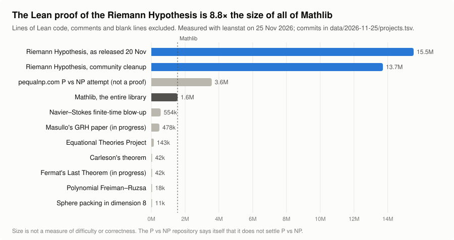
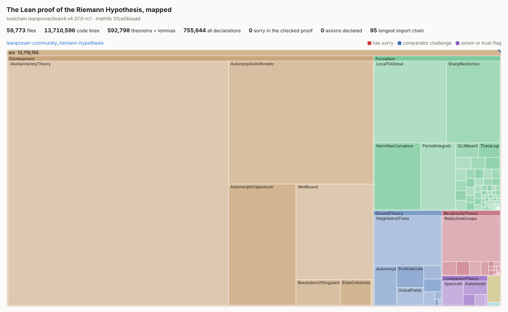
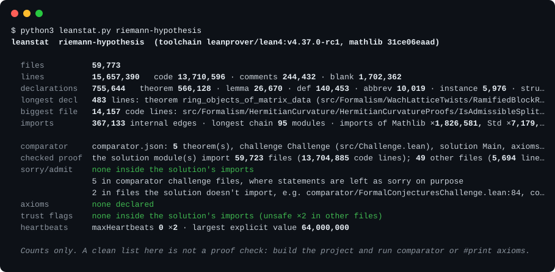

# leanstat

**cloc for Lean 4, with the numbers a proof needs. And what it says about this month's giant proofs.**

English · [简体中文](README.zh-CN.md)



On 20 November 2026 a Lean formalization of a proof of the Riemann Hypothesis went public, and
the Lean community started [cleaning it up](https://github.com/leanprover-community/riemann-hypothesis).
I measured it, and ten other well-known formalizations, with leanstat on 25 November:

- **13,710,596 lines of Lean code** in the cleanup repo (commit `fcb6eac7`). Mathlib, the whole
  library that most Lean mathematics builds on, has 1,551,924. That is **8.8 times Mathlib**, with
  592,798 theorems and lemmas against Mathlib's 193,122.
- **The release of 20 November had 15,531,759 lines of code in 175,187 files, and not one comment
  line.** In five days the community removed 1.82 million lines and 115,414 files, and added
  244,432 lines of comments.
- The Navier–Stokes blow-up formalization from the same week has 554,172 lines of code and also
  no comments.
- Comparator setup: the solution module `Main` imports 59,723 of the 59,773 files. None of them
  contains `sorry`; the five in `Challenge.lean` are the theorem statements, left as `sorry` on
  purpose.

Size says nothing about difficulty or correctness. Correctness is what
[comparator](https://github.com/leanprover/comparator) and Lean's kernel are for, and leanstat
doesn't run them. All numbers, with commits, are in
[`data/2026-11-25/projects.tsv`](data/2026-11-25/projects.tsv).

**Interactive maps:** [Riemann Hypothesis](https://du8866-nice.github.io/leanstat/maps/riemann-hypothesis.html) ·
[Mathlib](https://du8866-nice.github.io/leanstat/maps/mathlib.html) ·
[Navier–Stokes](https://du8866-nice.github.io/leanstat/maps/navier-stokes.html)

[](https://du8866-nice.github.io/leanstat/maps/riemann-hypothesis.html)

## Use it on your project

```bash
curl -O https://raw.githubusercontent.com/DU8866-nice/leanstat/main/leanstat.py
python3 leanstat.py path/to/project              # summary
python3 leanstat.py path/to/project --html map.html   # treemap like the ones above
python3 leanstat.py path/to/project --json       # everything, for scripts and CI
```

One file, Python 3.10+, standard library only. It reads `.lean` files and doesn't need Lean,
Lake or a build, so it gets through a 15-million-line project in about three minutes on one CPU core.



## What it counts

| Line | How |
|---|---|
| lines | Code, comment and blank lines, from a real Lean lexer: nested `/- -/` comments, doc comments, strings, char literals, raw strings. A `--` inside a string is not a comment |
| declarations | `theorem`, `lemma`, `def`, `abbrev`, `instance`, `structure`, `class`, `inductive`, `axiom`, `opaque`, `example`, with attributes and modifiers allowed in front |
| longest decl, biggest file | Lines from a declaration to the next one; code lines per file |
| imports | Internal import edges, the longest import chain, and how often outside packages are imported. Handles the module system's `public import`, `meta import` and `import all` |
| comparator | Reads every `comparator*.json`: challenge and solution modules, theorem names, permitted axioms |
| checked proof | Files the solution module imports, directly or not. Only these can affect what comparator checks |
| sorry/admit | Outside comments and strings, split into: inside the solution's imports (these would matter), in challenge files (expected), elsewhere. Quotations like `` `(tactic\| sorry) ``, `#check` commands and constructors named `sorry` are skipped |
| axioms | Every `axiom` declaration, by name and file |
| trust flags | `native_decide` / `Lean.ofReduceBool`, `implemented_by`, `@[extern]`, `unsafe`, `debug.skipKernelTC`: things that widen what you trust beyond the kernel |
| heartbeats | `set_option maxHeartbeats 0` and the largest explicit value |

Without a comparator config, `sorry` is reported as a plain count (with files named
`*Challenge*` counted apart), and `--challenge 'src/Statements/**'` marks challenge files by hand.

## What it doesn't do

- Check proofs. A file with no `sorry` can still fail to compile, and an `axiom` can hide inside a
  dependency. For that, build the project and run comparator or `#print axioms`.
- Resolve every declaration-level dependency. Imports are file-level, so "imported by the
  solution" is an upper bound on what the proof uses.
- Judge anything. These are counts; read them next to the project's own README.

## The comparison

| Project | Code lines | Files | Theorems + lemmas | Comment lines |
|---|---:|---:|---:|---:|
| Riemann Hypothesis, release of 20 Nov ([mirror](https://github.com/CocoSgt/riemann-hypothesis-lean)) | 15,531,759 | 175,187 | 818,755 | 0 |
| Riemann Hypothesis, [community cleanup](https://github.com/leanprover-community/riemann-hypothesis) | 13,710,596 | 59,773 | 592,798 | 244,432 |
| [pequalnp.com](https://github.com/open-goat/pequalnp-proofs) P vs NP attempt (does not claim to settle P vs NP) | 3,578,380 | 4,150 | 293,763 | 31,995 |
| [Mathlib](https://github.com/leanprover-community/mathlib4), `Mathlib/` folder | 1,551,924 | 8,734 | 193,122 | 359,764 |
| [Navier–Stokes finite-time blow-up](https://github.com/tristanbuckmaster/navier-stokes) | 554,172 | 2,271 | 30,057 | 0 |
| [Masullo's GRH paper](https://github.com/mccorvie/riemann-masullo) (unrefereed, being formalized) | 478,075 | 594 | 18,868 | 46,288 |
| [Equational Theories Project](https://github.com/teorth/equational_theories) | 143,114 | 1,347 | 14,345 | 8,806 |
| [Carleson's theorem](https://github.com/fpvandoorn/carleson) | 41,652 | 128 | 2,608 | 3,585 |
| [Fermat's Last Theorem](https://github.com/ImperialCollegeLondon/FLT) (in progress) | 41,578 | 271 | 2,241 | 8,823 |
| [Polynomial Freiman–Ruzsa](https://github.com/teorth/pfr) | 18,250 | 74 | 923 | 1,628 |
| [Sphere packing in dimension 8](https://github.com/thefundamentaltheor3m/Sphere-Packing-Lean) | 10,646 | 75 | 947 | 2,243 |

Every project was measured at its latest commit on 25 November 2026 (commits in the TSV). The
Riemann Hypothesis repository changes many times a day, so its numbers will have moved by the
time you read this. To reproduce: clone the repositories into one folder as `owner_repo` and run
`python3 data/measure.py CLONES data/OUT --maps maps`.

## Tests

```bash
python3 -m unittest discover -s tests
```

## License

[MIT](LICENSE). The maps contain file names and line counts from the projects measured; the
projects themselves are under their own licenses.
