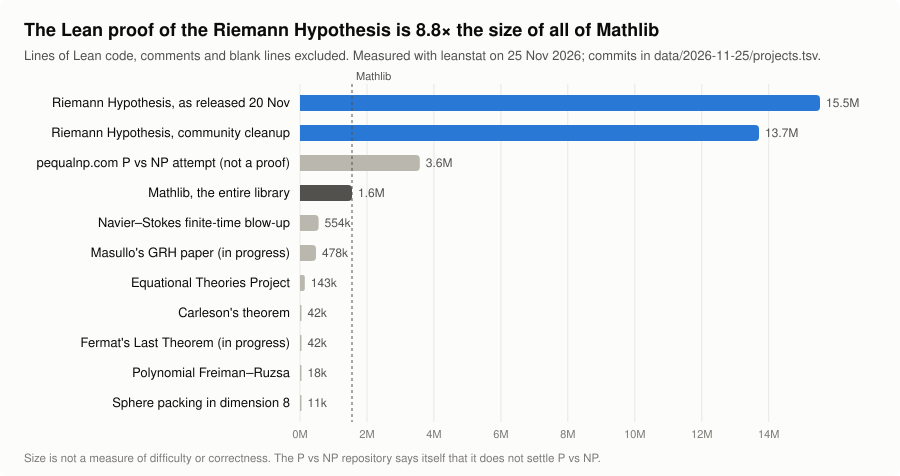
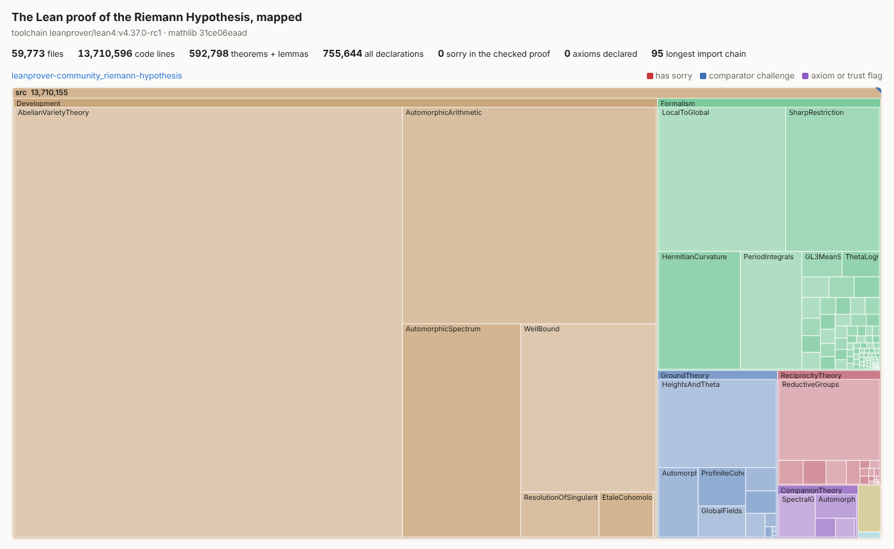
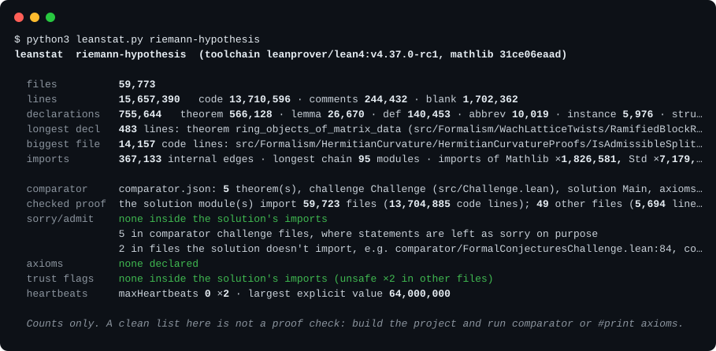

# leanstat

**Lean 4 版的 cloc，外加证明需要关心的数字。顺便看看这个月那几个巨型证明到底有多大。**

[English](README.md) · 简体中文



2026 年 11 月 20 日，一份黎曼猜想证明的 Lean 形式化公开发布，Lean 社区随即开始
[整理它](https://github.com/leanprover-community/riemann-hypothesis)。11 月 25 日，我用 leanstat 测了它和另外十个著名的形式化项目：

- 社区整理仓库（提交 `fcb6eac7`）有 **13,710,596 行 Lean 代码**。Mathlib 是大多数 Lean 数学所依赖的整个基础库，
  共 1,551,924 行。也就是说，**黎曼猜想的证明是 Mathlib 的 8.8 倍**，定理和引理 592,798 条，Mathlib 是 193,122 条。
- **11 月 20 日首次发布的版本有 15,531,759 行代码、175,187 个文件，一行注释都没有。** 五天里社区删掉了 182 万行代码和
  115,414 个文件，加了 244,432 行注释。
- 同一周发布的 Navier–Stokes 有限时间爆破形式化有 554,172 行代码，同样没有注释。
- comparator 配置方面：解答模块 `Main` 导入了 59,773 个文件中的 59,723 个，这些文件里没有一个 `sorry`；`Challenge.lean`
  里的 5 个 `sorry` 是定理陈述，按设计就是留空的。

规模不代表难度，也不代表正确性。正确性要靠 [comparator](https://github.com/leanprover/comparator) 和 Lean 内核来检查，
leanstat 不运行它们。所有数字和对应的提交都在 [`data/2026-11-25/projects.tsv`](data/2026-11-25/projects.tsv)。

**可交互的树图：** [黎曼猜想](https://du8866-nice.github.io/leanstat/maps/riemann-hypothesis.html) ·
[Mathlib](https://du8866-nice.github.io/leanstat/maps/mathlib.html) ·
[Navier–Stokes](https://du8866-nice.github.io/leanstat/maps/navier-stokes.html)

[](https://du8866-nice.github.io/leanstat/maps/riemann-hypothesis.html)

## 用在你自己的项目上

```bash
curl -O https://raw.githubusercontent.com/DU8866-nice/leanstat/main/leanstat.py
python3 leanstat.py path/to/project              # 摘要
python3 leanstat.py path/to/project --html map.html   # 生成上面那样的树图
python3 leanstat.py path/to/project --json       # 全部数据，给脚本和 CI 用
```

单文件，Python 3.10+，只用标准库。它只读 `.lean` 文件，不需要 Lean、Lake，也不用编译，单核三分钟左右就能跑完一个
1500 万行的项目。



## 统计什么

| 项目 | 做法 |
|---|---|
| 行数 | 用真正的 Lean 词法分析区分代码、注释、空行：嵌套的 `/- -/` 注释、文档注释、字符串、字符字面量、原始字符串。字符串里的 `--` 不算注释 |
| 声明 | `theorem`、`lemma`、`def`、`abbrev`、`instance`、`structure`、`class`、`inductive`、`axiom`、`opaque`、`example`，前面可以带属性和修饰符 |
| 最长声明、最大文件 | 从一个声明到下一个声明的行数；每个文件的代码行数 |
| 导入 | 内部导入边数、最长导入链、外部包被导入的次数。支持模块系统的 `public import`、`meta import`、`import all` |
| comparator | 读取所有 `comparator*.json`：challenge 和 solution 模块、定理名、允许的公理 |
| 被检查的证明 | solution 模块直接或间接导入的文件。只有这些会影响 comparator 的检查结果 |
| sorry/admit | 不算注释和字符串里的，分成三类：在 solution 的导入范围内（这些才要紧）、在 challenge 文件里（本该如此）、其他地方。`` `(tactic\| sorry) `` 这类语法引用、`#check` 命令和名叫 `sorry` 的构造子会被跳过 |
| 公理 | 每个 `axiom` 声明的名字和所在文件 |
| 信任标记 | `native_decide` / `Lean.ofReduceBool`、`implemented_by`、`@[extern]`、`unsafe`、`debug.skipKernelTC`：这些会让你需要信任的范围超出内核 |
| heartbeats | `set_option maxHeartbeats 0` 的次数和显式设置的最大值 |

没有 comparator 配置时，`sorry` 只给出总数（名字含 `*Challenge*` 的文件单独计），也可以用 `--challenge 'src/Statements/**'`
手动指定 challenge 文件。

## 它不做什么

- 不检查证明。没有 `sorry` 的文件也可能编译不过，`axiom` 也可能藏在依赖里。要确认正确性，请编译项目并运行 comparator
  或 `#print axioms`。
- 不解析声明级的依赖。导入是文件级的，所以「被 solution 导入」是证明实际用到内容的上界。
- 不下结论。这些只是计数，请结合项目自己的 README 来看。

## 对比表

完整表格见[英文 README](README.md#the-comparison)，原始数据在 [`data/2026-11-25/projects.tsv`](data/2026-11-25/projects.tsv)。
所有项目都按 2026 年 11 月 25 日的最新提交测量；黎曼猜想仓库一天会更新很多次，你读到时数字已经变了。复现方法：把各仓库
以 `owner_repo` 的名字克隆到同一个文件夹，运行 `python3 data/measure.py CLONES data/OUT --maps maps`。

## 测试

```bash
python3 -m unittest discover -s tests
```

## 许可证

[MIT](LICENSE)。树图里包含被测项目的文件名和行数，这些项目各自遵循自己的许可证。
